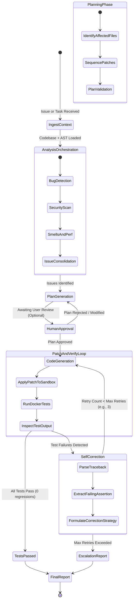

# RepoPilot AI — AI Agent Architecture

## 1. Overview & Framework Selection

RepoPilot AI uses **LangGraph** to implement a deterministic, stateful, multi-agent feedback loop. Rather than relying on unconstrained ReAct loops that can easily wander into hallucinations or infinite spending traps, LangGraph models the software engineering process as a typed state machine with explicit transitions, retry limits, and human-in-the-loop checkpoints.

---

## 2. Multi-Agent StateGraph Architecture



---

## 3. Agent Personas and Responsibilities

| Agent Persona | Role | Input | Output Artifact |
| :--- | :--- | :--- | :--- |
| **Supervisor / Router** | Evaluates overall state, monitors token budget, controls transitions, and halts executions upon threshold limits. | `RepoPilotState` | Next Node Router Decision |
| **Analysis Agent** | Discovers logic bugs, security vulnerabilities (OWASP), and anti-patterns using AST context and vector search. | AST symbols + code snippets | List of `DetectedIssue` objects |
| **Planner Agent** | Determines which files need changes, identifies cross-module dependencies, and produces a step-by-step fix strategy. | `DetectedIssue` + Repo Graph | `FixPlan` (ordered atomic steps) |
| **Coder Agent** | Produces syntactically valid patches or file replacements adhering strictly to the repository's existing code style. | Target files + Fix Plan | `UnifiedDiff` or File Replacement Map |
| **Verifier Agent** | Interfaces with the Docker sandbox, runs test suites, monitors timeouts, and parses stdout/stderr. | Test invocation parameters | `TestRunResult` with parsed traces |
| **Self-Correction Agent** | Diagnoses why a test failed (e.g., `AssertionError`, `ImportError`, regression in unrelated test) and provides corrective context. | `TestRunResult` + previous diff | Corrective prompt & updated plan |

---

## 4. LangGraph State Schema

The central state object passed between nodes is defined via Pydantic and TypedDict:

```python
from typing import Annotated, List, Dict, Optional, Any
from pydantic import BaseModel, Field
import operator

class Issue(BaseModel):
    id: str
    title: str
    file_path: str
    line_number: int
    severity: str
    description: str

class PlanStep(BaseModel):
    step_number: int
    target_file: str
    action: str
    rationale: str

class TestResult(BaseModel):
    passed: bool
    exit_code: int
    summary: str
    failing_tests: List[str]
    traceback: Optional[str] = None

class RepoPilotState(BaseModel):
    # Repository context
    repository_id: str
    workspace_path: str
    
    # Task & Issues
    task_description: str
    detected_issues: List[Issue] = Field(default_factory=list)
    active_issue: Optional[Issue] = None
    
    # Planning
    plan_steps: List[PlanStep] = Field(default_factory=list)
    human_approved: bool = False
    
    # Patch & Code
    proposed_diffs: Dict[str, str] = Field(default_factory=dict)
    
    # Execution & Verification
    retry_count: int = 0
    max_retries: int = 3
    latest_test_result: Optional[TestResult] = None
    execution_history: List[TestResult] = Field(default_factory=list)
    
    # Final output
    status: str = "INITIALIZED"
    final_report: Optional[str] = None
```

---

## 5. Google Gemini Model Integration

RepoPilot AI harnesses Google Gemini models:
- **Gemini 2.5 Flash / 3.0 Flash**: Fast, high-throughput analysis, file summarization, AST node tagging, and test trace parsing.
- **Gemini 2.5 Pro / 3.0 Pro**: Complex multi-file reasoning, strategic plan synthesis, and patch code generation.
- **Gemini Text Embedding (text-embedding-004)**: 768-dimensional code and symbol embeddings for pgvector RAG.

Structured outputs are enforced via Gemini native JSON Schema mode (`response_schema`), guaranteeing that issues, plans, and diffs conform strictly to Pydantic definitions without fragile regex extraction.

---

## 6. Observability & Evaluation

1. **Langfuse Integration**:
   - Traces every LangGraph node execution.
   - Measures prompt token usage, completion token usage, and latency per agent.
   - Records feedback scores and human approval status.
2. **DeepEval Evaluation Pipeline**:
   - Automated regression benchmarks using SWE-bench style test tasks.
   - Evaluates:
     - **Hallucination rate**: Does the code reference non-existent symbols or files?
     - **Syntactic correctness**: Does the generated code parse cleanly with Tree-sitter?
     - **Patch pass rate**: Percentage of Docker test runs passing on first try vs after self-correction.

