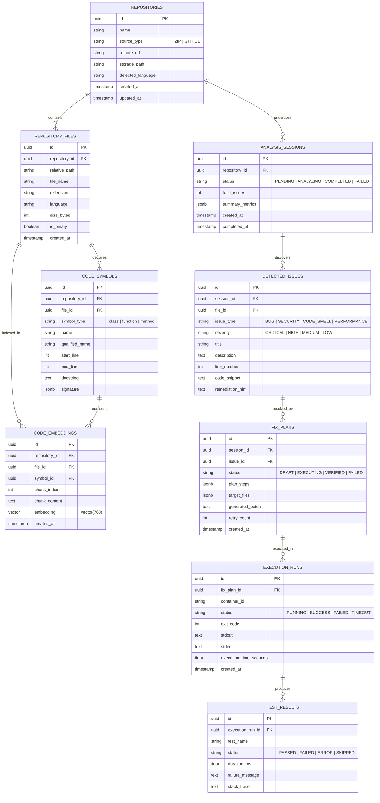

# RepoPilot AI — Database Design

## 1. Overview

RepoPilot AI utilizes **PostgreSQL 16** augmented with the **pgvector** extension. This relational + vector architecture provides:
- Relational integrity for repositories, files, structural AST symbols, issue tracking, and test execution runs.
- High-performance vector similarity search (via HNSW indexing) for semantic code retrieval (RAG).
- Transactional consistency to track multi-step agent plans and multi-round self-correction history.

---

## 2. Entity-Relationship Diagram (ERD)



---

## 3. Schema DDL & Specification

### 3.1 Extension Activation
```sql
CREATE EXTENSION IF NOT EXISTS "uuid-ossp";
CREATE EXTENSION IF NOT EXISTS "vector";
```

### 3.2 Repositories & File Hierarchy
```sql
CREATE TABLE repositories (
    id UUID PRIMARY KEY DEFAULT uuid_generate_v4(),
    name VARCHAR(255) NOT NULL,
    source_type VARCHAR(50) NOT NULL, -- 'ZIP' or 'GITHUB'
    remote_url VARCHAR(1024),
    storage_path VARCHAR(1024) NOT NULL,
    detected_language VARCHAR(50),
    created_at TIMESTAMP WITH TIME ZONE DEFAULT NOW(),
    updated_at TIMESTAMP WITH TIME ZONE DEFAULT NOW()
);

CREATE TABLE repository_files (
    id UUID PRIMARY KEY DEFAULT uuid_generate_v4(),
    repository_id UUID NOT NULL REFERENCES repositories(id) ON DELETE CASCADE,
    relative_path VARCHAR(1024) NOT NULL,
    file_name VARCHAR(255) NOT NULL,
    extension VARCHAR(50),
    language VARCHAR(50),
    size_bytes INTEGER NOT NULL,
    is_binary BOOLEAN DEFAULT FALSE,
    created_at TIMESTAMP WITH TIME ZONE DEFAULT NOW(),
    CONSTRAINT uq_repo_path UNIQUE (repository_id, relative_path)
);
```

### 3.3 Syntactic Intelligence & Embeddings (pgvector)
```sql
CREATE TABLE code_symbols (
    id UUID PRIMARY KEY DEFAULT uuid_generate_v4(),
    repository_id UUID NOT NULL REFERENCES repositories(id) ON DELETE CASCADE,
    file_id UUID NOT NULL REFERENCES repository_files(id) ON DELETE CASCADE,
    symbol_type VARCHAR(50) NOT NULL, -- 'class', 'function', 'method'
    name VARCHAR(255) NOT NULL,
    qualified_name VARCHAR(512),
    start_line INTEGER NOT NULL,
    end_line INTEGER NOT NULL,
    docstring TEXT,
    signature JSONB,
    created_at TIMESTAMP WITH TIME ZONE DEFAULT NOW()
);

CREATE TABLE code_embeddings (
    id UUID PRIMARY KEY DEFAULT uuid_generate_v4(),
    repository_id UUID NOT NULL REFERENCES repositories(id) ON DELETE CASCADE,
    file_id UUID NOT NULL REFERENCES repository_files(id) ON DELETE CASCADE,
    symbol_id UUID REFERENCES code_symbols(id) ON DELETE SET NULL,
    chunk_index INTEGER NOT NULL,
    chunk_content TEXT NOT NULL,
    embedding VECTOR(768), -- Google Gemini Text Embedding 004 dimension
    created_at TIMESTAMP WITH TIME ZONE DEFAULT NOW()
);

-- Fast cosine similarity search with HNSW Index
CREATE INDEX idx_code_embeddings_hnsw 
ON code_embeddings 
USING hnsw (embedding vector_cosine_ops)
WITH (m = 16, ef_construction = 64);
```

### 3.4 Analysis Sessions & Issues
```sql
CREATE TABLE analysis_sessions (
    id UUID PRIMARY KEY DEFAULT uuid_generate_v4(),
    repository_id UUID NOT NULL REFERENCES repositories(id) ON DELETE CASCADE,
    status VARCHAR(50) NOT NULL DEFAULT 'PENDING',
    total_issues INTEGER DEFAULT 0,
    summary_metrics JSONB,
    created_at TIMESTAMP WITH TIME ZONE DEFAULT NOW(),
    completed_at TIMESTAMP WITH TIME ZONE
);

CREATE TABLE detected_issues (
    id UUID PRIMARY KEY DEFAULT uuid_generate_v4(),
    session_id UUID NOT NULL REFERENCES analysis_sessions(id) ON DELETE CASCADE,
    file_id UUID REFERENCES repository_files(id) ON DELETE SET NULL,
    issue_type VARCHAR(50) NOT NULL, -- 'BUG', 'SECURITY', 'CODE_SMELL', 'PERFORMANCE'
    severity VARCHAR(20) NOT NULL,   -- 'CRITICAL', 'HIGH', 'MEDIUM', 'LOW'
    title VARCHAR(500) NOT NULL,
    description TEXT NOT NULL,
    line_number INTEGER,
    code_snippet TEXT,
    remediation_hint TEXT,
    created_at TIMESTAMP WITH TIME ZONE DEFAULT NOW()
);
```

### 3.5 Fix Plans, Execution & Validation
```sql
CREATE TABLE fix_plans (
    id UUID PRIMARY KEY DEFAULT uuid_generate_v4(),
    session_id UUID NOT NULL REFERENCES analysis_sessions(id) ON DELETE CASCADE,
    issue_id UUID REFERENCES detected_issues(id) ON DELETE SET NULL,
    status VARCHAR(50) NOT NULL DEFAULT 'DRAFT',
    plan_steps JSONB NOT NULL,
    target_files JSONB NOT NULL,
    generated_patch TEXT,
    retry_count INTEGER DEFAULT 0,
    created_at TIMESTAMP WITH TIME ZONE DEFAULT NOW()
);

CREATE TABLE execution_runs (
    id UUID PRIMARY KEY DEFAULT uuid_generate_v4(),
    fix_plan_id UUID NOT NULL REFERENCES fix_plans(id) ON DELETE CASCADE,
    container_id VARCHAR(128),
    status VARCHAR(50) NOT NULL, -- 'RUNNING', 'SUCCESS', 'FAILED', 'TIMEOUT'
    exit_code INTEGER,
    stdout TEXT,
    stderr TEXT,
    execution_time_seconds FLOAT,
    created_at TIMESTAMP WITH TIME ZONE DEFAULT NOW()
);

CREATE TABLE test_results (
    id UUID PRIMARY KEY DEFAULT uuid_generate_v4(),
    execution_run_id UUID NOT NULL REFERENCES execution_runs(id) ON DELETE CASCADE,
    test_name VARCHAR(512) NOT NULL,
    status VARCHAR(50) NOT NULL, -- 'PASSED', 'FAILED', 'ERROR', 'SKIPPED'
    duration_ms FLOAT,
    failure_message TEXT,
    stack_trace TEXT,
    created_at TIMESTAMP WITH TIME ZONE DEFAULT NOW()
);
```

