# RepoPilot AI — Development Roadmap

## 1. Incremental Delivery Strategy

RepoPilot AI is developed following a rigorous phase-gate methodology. Each phase produces working, testable code with defined acceptance criteria before moving forward.

```mermaid
flowchart LR
    P0[Phase 0: Architecture & Foundation] --> P1[Phase 1: Ingestion & Storage]
    P1 --> P2[Phase 2: Code Intelligence & AST]
    P2 --> P3[Phase 3: pgvector & Hybrid RAG]
    P3 --> P4[Phase 4: AI Code Analysis]
    P4 --> P5[Phase 5: Agentic Planning & Patching]
    P5 --> P6[Phase 6: Docker Sandboxing & Testing]
    P6 --> P7[Phase 7: Self-Correction Loop]
    P7 --> P8[Phase 8: Interactive UI & Review Platform]
```

---

## 2. Phase Breakdown & Milestones

### Phase 0: Architecture, Foundation & Initialization (Completed)
- **Objective**: Establish monorepo structure, system architecture, data models, developer tooling, and working frontend + backend baselines.
- **Key Deliverables**:
  - Full system architecture documentation (`docs/*`).
  - Monorepo directory structure (`frontend/`, `backend/`, `docs/`).
  - React + TypeScript + Vite + Tailwind CSS frontend baseline.
  - FastAPI backend baseline with health checks and CORS configuration.
  - Environment templates (`.env.example`) and comprehensive `.gitignore`.
- **Acceptance Criteria**:
  - Backend starts cleanly; `/api/v1/health` responds with HTTP 200 and system metadata.
  - Frontend starts cleanly; communicates with backend health endpoint.

---

### Phase 1: Repository Ingestion & File Indexing (Completed)
- **Objective**: Ingest codebases safely from ZIP files or GitHub URLs and create an indexed file catalog.
- **Key Deliverables**:
  - Safe ZIP unpacker with directory traversal protection (`zipfile`).
  - Cross-platform Git repository cloner via `subprocess.run` with timeout protection and permission cleanup.
  - Directory walker honoring `.gitignore` rules (using `pathspec`).
  - File metadata extraction (size, extension, language distribution).
  - Workspace storage hierarchy and metadata persistence (`metadata.json`).
- **Acceptance Criteria**:
  - Uploading a sample repo ZIP or cloning a public GitHub URL stores files safely and returns structured file tree.

---

### Phase 2: Code Intelligence & AST Parsing (Completed)
- **Objective**: Parse source code into symbols, structures, dependencies, and call graphs.
- **Key Deliverables**:
  - Python AST parser extracting functions (sync/async), classes, methods, docstrings, parameters, decorators, and imports.
  - Tree-sitter multi-language parser interface supporting 10 languages (Python, JavaScript, TypeScript, TSX, Java, C, C++, Go, Rust, PHP, Ruby).
  - Multi-language import dependency resolver with relative and module path resolution.
  - Circular dependency detection via DFS cycle finding.
  - Function call graph resolver mapping caller-to-callee invocations with static resolution status.
  - Code intelligence REST endpoints (`/analyze`, `/analysis`, `/symbols`, `/dependencies`, `/call-graph`, `/files/{path}/analysis`).
  - React Code Intelligence dashboard explorer with symbols, dependencies, and call graph tabs.
- **Acceptance Criteria**:
  - Querying any ingested repository returns complete code intelligence payload with deterministic symbol IDs, dependency matrix, circular dependency detection, and call graph.

---

### Phase 3: pgvector RAG & Code Embeddings (Completed)
- **Objective**: Enable semantic and hybrid search over the repository using dense vector embeddings and lexical indexing.
- **Key Deliverables**:
  - AST-aware code chunking aligned to function, class, and method boundaries with contextual scope headers.
  - Sub-chunking for oversized symbols with line overlap and signature preservation.
  - Safe line-based sliding-window fallback chunking for unsupported formats.
  - Embedding pipeline supporting Google Gemini `text-embedding-004` (768 dimensions) with batching and exponential backoff, plus offline deterministic mock provider.
  - Incremental indexing via SHA-256 content hashes to eliminate redundant embedding computation.
  - PostgreSQL + pgvector vector store (`CodeChunkModel`) with cosine distance (`<=>`) and fallback local workspace cache.
  - Hybrid retrieval combining dense vector similarity with lexical keyword search via Reciprocal Rank Fusion (RRF).
  - Code search REST endpoints (`/index`, `/index/status`, `/index/stats`, `/search`, `/index` [DELETE]).
  - Interactive React code search dashboard section with relevance scores and retrieval method badges.
- **Acceptance Criteria**:
  - Querying any ingested repository via hybrid search returns ranked code chunks with accurate file paths, line ranges, symbol names, and relevance percentages.

---

### Phase 4: AI-Powered Code Analysis & Bug Detection (Completed)
- **Objective**: Identify logic errors, security vulnerabilities, and code quality issues using AST context, hybrid RAG retrieval, and schema-enforced Gemini reasoning.
- **Key Deliverables**:
  - Modular AI analysis engine (`backend/app/analysis/`):
    - Multi-category bug detection: Logic Bugs (zero division, None dereferences, infinite loops), Security Vulnerabilities (CWE-89 SQLi, CWE-78 Command Injection, CWE-22 Path Traversal, CWE-798 Hardcoded Secrets, CWE-79 XSS), and Code Smells (nesting, dead code, complexity).
    - Structured Pydantic schema validation (`CodeIssue`, `AnalysisRun`, `IssueListResponse`, `AnalysisRunStatusResponse`).
    - Context builder combining target code slice + Phase 2 AST signature metadata + Phase 3 hybrid RAG caller/callee context.
    - Confidence validator ensuring evidence text matches source file, validating line boundaries, and deduplicating findings.
    - Prompt injection defenses treating repository code as strictly untrusted data.
    - Dual persistence via PostgreSQL (`CodeAnalysisRunModel`, `CodeIssueModel`) and local workspace fallback (`issues.json`).
    - Deterministic offline mock analyzer (`MockCodeAnalyzer`) for reproducible CI/CD testing.
  - REST endpoints (`/ai-analyze`, `/ai-analyze/file`, `/ai-analyze/function`, `/ai-analysis/status`, `/issues`, `/issues/{id}`, `/issues/{id}/status`).
  - Interactive React code analysis dashboard section (`CodeAnalysisSection.tsx`) with severity metric cards, filterable issue list, verbatim evidence viewer, and status mutation controls.
- **Acceptance Criteria**:
  - Running code analysis against target repositories detects logic bugs, OWASP vulnerabilities, and code smells with accurate line numbers, verbatim evidence, impact analysis, CWE classifications, and remediations.

---

### Phase 5: Agentic Planning & Autonomous Code Fixing (Current Phase)
- **Objective**: Create multi-step repair plans and synthesize multi-file code diffs.
- **Key Deliverables**:
  - LangGraph Planner node generating sequential fix actions.
  - LangGraph Coder node generating clean patches (unified diff format).
  - Multi-file patch applicator with file backup and rollback capabilities.
- **Acceptance Criteria**:
  - Given a detected issue, the agent outputs a valid unified diff modifying only the necessary files.

---

### Phase 6: Docker Sandbox Execution & Testing
- **Objective**: Execute test suites securely in isolated containers without host danger.
- **Key Deliverables**:
  - Docker-py orchestrator running containers with CPU/RAM caps and disabled network.
  - Pytest runner streaming test discovery and execution logs.
  - Output parser categorizing passed, failed, and skipped tests with tracebacks.
- **Acceptance Criteria**:
  - Containers start, run `pytest`, return structured test outcomes, and clean up automatically.

---

### Phase 7: Self-Correction Feedback Loop
- **Objective**: Iteratively resolve test failures automatically.
- **Key Deliverables**:
  - Traceback parser extracting failing assertions, exceptions, and line numbers.
  - LangGraph self-correction node feeding test failures back into the coder agent.
  - Max retry guardrail (default: 3 iterations) to halt infinite loops.
- **Acceptance Criteria**:
  - Agent fixes a failing test suite iteratively within 1-2 attempts and halts when all tests pass.

---

### Phase 8: Code Review UI & Full Platform Polish
- **Objective**: Deliver a production-grade developer review experience.
- **Key Deliverables**:
  - Interactive multi-file diff viewer with syntax highlighting.
  - Live agent reasoning timeline with SSE streaming.
  - Docker test output console with real-time log tailing.
  - Exportable final analysis and fix report (Markdown & JSON).
  - End-to-end integration tests and DeepEval benchmark evaluation.
- **Acceptance Criteria**:
  - Complete end-to-end workflow: Upload Repo -> Analyze -> Plan -> Fix -> Test Sandbox -> Self-Correct -> Review in UI.

