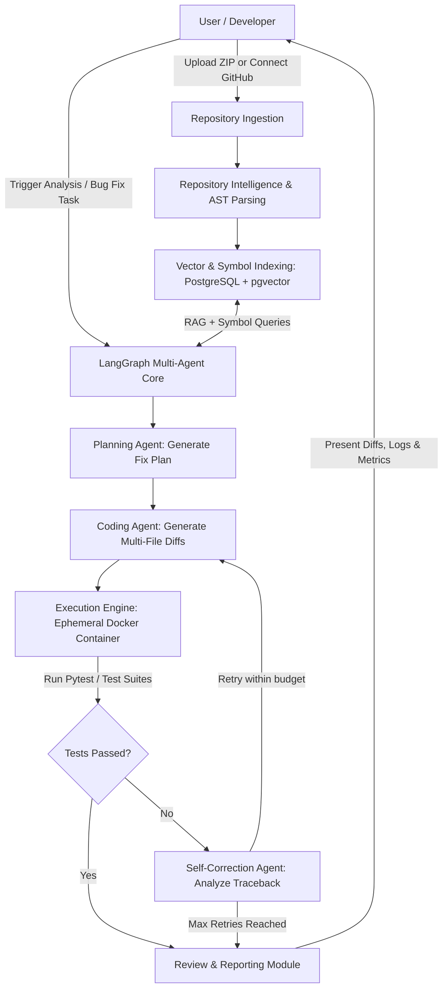

# RepoPilot AI — Project Overview

## 1. Executive Summary

**RepoPilot AI** is an autonomous AI-powered software engineering platform engineered to ingest, understand, analyze, modify, and validate multi-file codebases. Unlike single-prompt conversational code assistants or simple autocomplete tools, RepoPilot AI functions as a complete virtual software engineer. It perceives whole-repository context, reasons over multi-file dependencies, formulates structured fix plans, applies multi-file refactors or bug fixes, and rigorously verifies changes through isolated containerized test execution and self-correcting feedback loops.

---

## 2. Problem Statement

Modern software development faces several bottlenecks that simple chatbot interfaces fail to solve:

1. **Context Fragmentation**: Chatbots operate on snippet-level inputs (typically limited to what fits in a prompt or active editor tab). Real-world bugs span configuration files, database schemas, interfaces, and implementation classes.
2. **Hallucination Without Verification**: LLM-generated code often introduces syntax regressions, broken imports, or subtle logical errors. Without automated test-driven verification, developers spend excessive time manually debugging AI output.
3. **Lack of Autonomous Planning**: Complex tasks (e.g., upgrading a library, fixing a cross-module race condition, or patching a security vulnerability) require a sequence of dependent changes across multiple files.
4. **Security Risks in Execution**: Running code generated by an AI directly on developer workstations or staging servers without strict sandboxing creates severe security and isolation risks.

---

## 3. Product Vision & Value Proposition

RepoPilot AI solves these challenges by combining:
- **Repository Ingestion & Syntax-Aware Parsing**: Extracting ASTs, symbols, call graphs, and dependency trees using Tree-sitter and Python AST.
- **Hybrid Retrieval (RAG + Code Graph)**: Combining dense vector search (pgvector + semantic code embeddings) with structured symbol/dependency navigation.
- **LangGraph Multi-Agent Orchestration**: Coordinating specialized agent personas (Planner, Analyst, Coder, Verifier, Self-Corrector) using cyclical state graphs.
- **Dockerized Sandbox Execution**: Running test suites (`pytest`, language test runners) in isolated ephemeral containers to validate fixes before presenting them to humans.
- **Autonomous Self-Correction**: Feeding test failure traces and stderr back into the agentic loop to iteratively repair failures up to a configurable ceiling.
- **Transparent Human-in-the-Loop Review**: Presenting unified diffs, execution logs, test output, and structural risk summaries before any pull request or merge operation.

---

## 4. User Personas & Use Cases

### Personas
- **Senior Software Engineers & Tech Leads**: Delegating bug investigation, regression debugging, repetitive refactoring, and dependency upgrades.
- **Open Source Maintainers**: Triaging issues, reproducing reported bugs in sandboxes, and evaluating proposed bug fixes.
- **Security & QA Engineers**: Running comprehensive static/dynamic vulnerability scans and generating verified patch candidates with zero host risk.

### Core Use Cases
| Use Case | Description | Agentic Capability |
| :--- | :--- | :--- |
| **Autonomous Bug Resolution** | Ingest a repo, reproduce a failing test or issue description, plan a multi-file patch, and verify all tests pass. | Multi-file patch synthesis + Docker test execution |
| **Security & Vulnerability Patching** | Scan for OWASP Top 10 vulnerabilities (SQLi, SSRF, IDOR, path traversal), isolate affected endpoints, and refactor code safely. | Static analysis + AST-guided rewriting |
| **Code Health & Technical Debt Refactoring** | Identify dead code, anti-patterns, missing type annotations, and legacy API usage across the repository. | Code graph traversal + batched refactoring |
| **Interactive Code Review & Diffs** | Review suggested changes with side-by-side diffs, test pass/fail indicators, and execution traces. | Transparent UI reporting & Git diff streaming |

---

## 5. High-Level System Workflow

---

## 6. Core Modules Overview

1. **Repository Ingestion Module**: Handles ZIP archive uploads, GitHub repository cloning via GitPython, directory tree indexing, language/framework detection, and file filtering (respecting `.gitignore`).
2. **Repository Intelligence Module**: Parses source files using Tree-sitter and AST engines, extracts symbols (classes, functions, methods, imports), and builds a navigable dependency graph.
3. **AI Code Analysis Module**: Identifies logical flaws, security anti-patterns, performance bottlenecks, and architectural debt using Google Gemini models with structured Pydantic schemas.
4. **Agentic Planning Module**: Synthesizes analysis findings or user issue descriptions into a directed dependency plan specifying which files must be altered and in what order.
5. **Autonomous Code Fixing Module**: Generates syntactically correct code replacements or patch diffs across single or multiple files while preserving conventions and style.
6. **Automated Testing & Sandboxing Module**: Spins up isolated Docker containers with pre-built runtime environments, mounts repository snapshots, and runs test suites (`pytest`).
7. **Self-Correction Engine**: If a test fails, extracts stack traces and compiler/interpreter errors, injects them into the agent state, and iteratively re-plans fixes.
8. **Code Review & Reporting Interface**: Modern React dashboard that visualizes code trees, issues, interactive git-style diffs, test output, and exportable reports.

