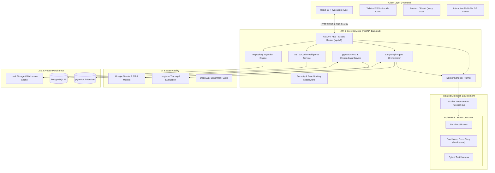
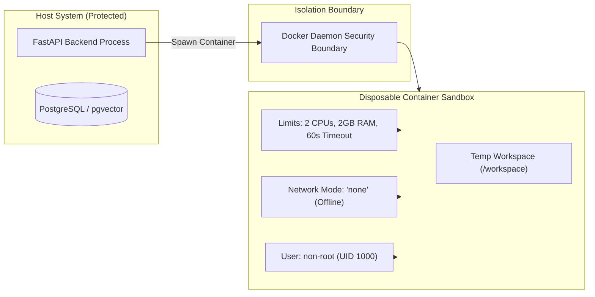

# RepoPilot AI — System Architecture

## 1. Architectural Philosophy

RepoPilot AI is designed around five foundational engineering principles:

1. **Strict Sandboxing (Zero Host Execution)**: Untrusted or AI-modified code is never executed directly on the host machine. All code execution, test verification, and script evaluation occur inside ephemeral Docker containers with strict resource and network boundaries.
2. **Deterministic Agent Workflows with LangGraph**: LLM interactions are orchestrated through stateful, cyclic directed graphs rather than uncontrolled autonomous loops. Each step produces structured, validated artifacts (Pydantic models).
3. **Hybrid Code Intelligence**: Vector retrieval (RAG) is augmented with syntactic structural knowledge (Abstract Syntax Trees via Tree-sitter and Python AST) to ensure both semantic relevance and lexical precision.
4. **Observable State & Streaming Feedback**: Agent reasoning steps, tool invocations, and execution logs stream to the frontend via Server-Sent Events (SSE), providing complete real-time transparency.
5. **Decoupled Monorepo Architecture**: Frontend (React + Vite + Tailwind) and Backend (FastAPI + Python) are cleanly separated, sharing strict schema contracts.

---

## 2. Global System Component Diagram



---

## 3. Communication Protocols

| Interface | Protocol | Purpose | Payload Format |
| :--- | :--- | :--- | :--- |
| **Frontend to Backend** | HTTP / JSON | Repository ingestion, configuration, session control | REST JSON (Pydantic validated) |
| **Backend to Frontend** | Server-Sent Events (SSE) | Live streaming of agent thought processes, diffs, and execution logs | JSON event stream (`event: step`, `event: test_log`) |
| **Backend to Google Gemini** | HTTPS / gRPC | Model inference, tool calling, structured JSON output | Gemini SDK / LangChain ChatGoogleGenerativeAI |
| **Backend to PostgreSQL** | Asyncpg / SQLAlchemy | Storage of repository metadata, AST symbols, embeddings, run histories | PostgreSQL Binary Protocol |
| **Backend to Docker Daemon** | Named Pipe (Windows) / Unix Socket | Spawning ephemeral execution sandboxes, streaming stdout/stderr | Docker Engine REST API via `docker-py` |
| **Backend to Langfuse** | HTTPS / OpenTelemetry | Telemetry, token counts, latency tracking, agent traces | Langfuse SDK / OTel Protocol |

---

## 4. Backend Modular Decomposition

The backend source tree is organized into isolated, cohesive domain packages under `backend/app/`:

```
backend/
├── app/
│   ├── main.py                  # Application entry point, lifespan, CORS, exception handlers
│   ├── core/                    # Core infrastructure: configuration, logging, security
│   │   ├── config.py            # Pydantic Settings (env validation)
│   │   ├── logging.py           # Structured JSON logger
│   │   └── security.py          # API token validation and safe file path utilities
│   ├── api/                     # REST & SSE endpoints
│   │   ├── v1/
│   │   │   ├── router.py        # Master API v1 router
│   │   │   ├── health.py        # Health and readiness probes
│   │   │   ├── repositories.py  # Repo upload, clone, and tree queries
│   │   │   ├── analysis.py      # Code analysis trigger and results
│   │   │   └── execution.py     # Sandbox execution and test streaming
│   ├── schemas/                 # Data transfer models (Pydantic v2)
│   │   ├── common.py
│   │   ├── repository.py
│   │   ├── analysis.py
│   │   └── execution.py
│   ├── services/                # Business logic coordinators
│   │   └── repo_manager.py
│   ├── repository/              # Repository ingestion & file management
│   │   ├── ingester.py          # ZIP unpacking & GitHub git clone
│   │   ├── walker.py            # .gitignore-aware directory traverser
│   │   └── detector.py          # Language and framework detector
│   ├── code_analysis/           # Syntactic & static code intelligence
│   │   ├── schemas.py           # AST Symbols, Imports, CallGraph & Dependency models
│   │   ├── python_parser.py     # Python AST parser (functions, classes, docstrings, calls)
│   │   ├── tree_sitter_parser.py# Tree-sitter polyglot parser (10 languages)
│   │   ├── parser_manager.py    # Polyglot parser dispatcher
│   │   ├── dependency_resolver.py# Import dependency resolver & circular cycle detector
│   │   ├── call_graph.py        # Caller-to-callee call graph resolver
│   │   └── service.py           # CodeAnalysisService orchestrator & disk persistence
│   ├── rag/                     # Vector retrieval & embeddings
│   │   ├── schemas.py           # Chunking, search query, and indexing schemas
│   │   ├── chunker.py           # AST-aware code chunker & sliding-window fallback
│   │   ├── embeddings.py        # Gemini text-embedding-004 & mock embedding pipeline
│   │   ├── hybrid_search.py     # Reciprocal Rank Fusion (RRF) ranker
│   │   ├── vector_store.py      # pgvector + local workspace vector store
│   │   └── service.py           # RAGService orchestrator & context retrieval
│   ├── analysis/                # AI-powered code analysis & bug detection (Phase 4)
│   │   ├── schemas.py           # CodeIssue, AnalysisRun, and request/response models
│   │   ├── context_builder.py   # Synthesizes target code + AST metadata + RAG snippets
│   │   ├── issue_classifier.py  # CWE taxonomy classifier & severity normalizer
│   │   ├── confidence.py        # Line boundary, verbatim evidence & deduplication validator
│   │   ├── prompts.py           # Gemini prompt templates & prompt injection defense directives
│   │   ├── analyzer.py          # GeminiCodeAnalyzer & deterministic MockCodeAnalyzer
│   │   └── service.py           # BugDetectionService & dual persistence coordinator
│   ├── database/                # Database connection & models
│   │   ├── session.py           # Async SQLAlchemy session factory & connection verification
│   │   └── models.py            # CodeChunkModel, CodeAnalysisRunModel, CodeIssueModel
│   ├── agents/                  # LangGraph multi-agent orchestration
│   │   ├── state.py             # Shared agent state definitions
│   │   ├── graph.py             # LangGraph state machine definition
│   │   ├── planner.py           # Strategic bug planning agent
│   │   ├── coder.py             # Multi-file patch generation agent
│   │   └── verifier.py          # Test verification & diagnostic agent
│   ├── execution/               # Sandboxed container runner
│   │   ├── docker_runner.py     # Docker container manager & timeout guard
│   │   └── sandbox_config.py    # Resource quotas (CPU, memory, no-network)
│   └── testing/                 # Test runners and parser
│       └── pytest_parser.py     # Pytest output & failure trace extractor
├── tests/                       # Unit and integration test suite
├── pyproject.toml               # Project dependencies and packaging
└── .env.example                 # Environment variables specification
```

---

## 5. Security & Isolation Architecture

Because RepoPilot AI ingests and modifies external, untrusted source code, security boundaries are paramount:



### Safety Controls
1. **Network Disablement**: During test execution, containers run in `--network=none` mode to prevent data exfiltration, SSRF attacks, or remote command downloads.
2. **Resource Constraints**: Hard limits of 2 CPUs, 2GB RAM, and a 60-second execution timeout protect against infinite loops, fork bombs, and memory exhaustion.
3. **Non-Root Execution**: Container commands execute under an unprivileged user (`uid: 1000`).
4. **Path Traversal Guards**: The backend validates all file paths during extraction to prevent directory traversal (`../` attacks).

